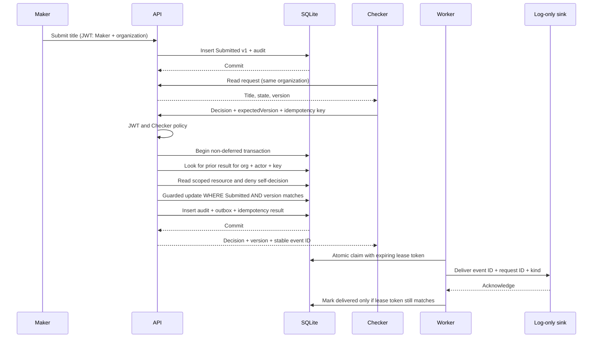

# Architecture and trade-offs

## Decision path

The diagram shows the successful decision path. A matching idempotency result returns before a new state change. A different request ID, version or decision under that key is a conflict.

## Invariants

1. Only a Maker policy can submit. Only a Checker policy can decide.
2. JWT subject, roles and organization come from a validated token, never a request body or custom identity header.
3. Reads and decisions include the caller's organization in the resource lookup.
4. The maker's subject cannot decide that same request, even if the subject also has the Checker role.
5. A submitted title cannot be edited through this API. A corrected submission requires a new request and a new review.
6. Each request has one terminal decision. The guarded update includes both submitted state and expected version.
7. A committed decision has its audit row, idempotency result and notification event in the same transaction.
8. Idempotency keys are actor- and organization-scoped. A successful repeated command returns the stored result.

These are application and database-transaction guarantees within this adapter. They do not protect against a compromised issuer, a database administrator changing rows, or someone bypassing the API with database credentials.

## Concurrency

A non-deferred SQLite transaction takes a write reservation before reading decision state. The SQL update also checks state and version. SQLite serializes writers; a second decision sees the completed decision or fails the guard. The provider's busy timeout is 10 seconds in the default connection string. Prolonged contention can return a generic server error. There is no throughput or distributed-scaling claim.

A move to SQL Server should preserve the atomic guarded update, transaction and unique idempotency scope, but use provider-specific SQL and validate the actual isolation/deadlock behavior. Do not copy SQLite concurrency assumptions into another provider.

## Outbox

The worker atomically claims one available row with a 60-second lease and a fresh lease token. It passes a 20-second cancellation token to the sink. Failure releases the row with a five-second retry delay. A process crash leaves a recoverable lease. Acknowledgment is conditional on the lease token, so a worker cannot acknowledge another worker's active lease.

A sink must honor cancellation and deduplicate stable event IDs. If delivery succeeds and the process crashes before acknowledgment, a later worker can deliver the same event again. The project deliberately demonstrates this boundary in a failure-path test. It does not implement exactly-once remote delivery.

This demo retries indefinitely. There is no dead-letter queue, adaptive backoff, lease renewal or backlog alert. Those are explicit operational gaps, not hidden features.

## Audit and privacy

Audit rows record request ID, actor subject, action, version and UTC timestamp. They omit the title and token. Application code appends audit rows during writes, but SQLite administrators can alter or delete them. This is not a tamper-evident or compliance-grade audit store.

The only sink logs an event ID and kind. There is no user-facing notification channel. Use synthetic titles only. A real deployment needs data classification, access control, retention, encrypted storage and tested backup/restore.

## Scope choices

There are no mutable drafts, edit/revision history, multi-stage chains, delegation, approval limits, organizational hierarchy, attachments, login UI or administrative role-management endpoints. This narrow scope makes the race, authorization and persistence behavior inspectable. Adding those features changes the threat model and requires new tests.
